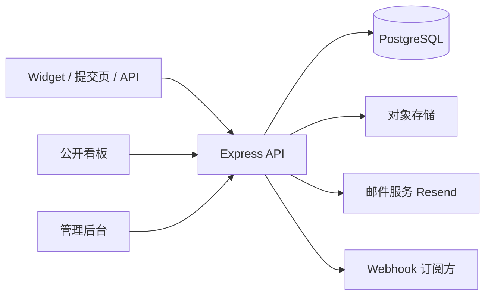

# Nexus Feedback

**面向开发者的开源用户反馈管理平台** — 把 Widget、公开提交页、API 和公开看板里的用户声音收进同一个收件箱，
完成分类、投票、指派、状态流转与更新日志闭环，让每一条反馈都有人回应。

[](./LICENSE)


- 🌐 在线演示：<https://feedback.fadai.xyz>
- 📚 文档目录：[docs/](./docs)
- 📄 许可证：[MIT](./LICENSE) · 第三方软件声明：[THIRD_PARTY_NOTICES.md](./THIRD_PARTY_NOTICES.md)

## 目录

- [核心功能](#核心功能)
- [技术栈](#技术栈)
- [项目结构](#项目结构)
- [快速开始](#快速开始)
- [默认演示账号](#默认演示账号)
- [接入方式](#接入方式)
- [环境变量](#环境变量)
- [质量与验证](#质量与验证)
- [生产部署](#生产部署)
- [安全设计](#安全设计)
- [文档索引](#文档索引)
- [贡献](#贡献)
- [许可证](#许可证)

## 核心功能

### 反馈管理
- **多渠道收集**：Widget 嵌入、公开提交页、公开 API、CSV 批量导入
- **分类与优先级**：项目级自定义分类；优先级 low/medium/high/critical
- **投票**：邮箱标识、无需注册，按热度排序
- **合并建议**：基于标题与内容相似度的候选推荐，合并后投票自动去重
- **附件**：图片 / PDF，支持本地、S3 兼容、七牛云
- **回收站**：软删除与恢复
- **复制为 Markdown**：一键导出反馈（含元信息、附件、回复）

### 团队协作
- **多租户**：组织 → 项目 → 成员（Owner / Admin / Member）
- **指派与内部备注**
- **标签系统** + 批量操作
- **审计日志**：完整记录成员操作
- **已保存视图**：筛选条件保存，服务端同步、跨设备可用

### 通知中心
- 站内通知（新反馈 / 指派 / 状态变更 / 评论），结构化参数 + 中英文渲染
- 通知偏好、**免打扰时段**（最多 5 个时间窗，支持跨午夜）、**按项目静音**
- 类型筛选、按类型标记已读、清空全部

### 数据洞察
- 反馈趋势、来源/分类分布、平均首次响应时间
- 统计卡片、最近动态、分配给我
- CSV 导出（含标签、负责人）

### 公开体验
- **公开看板**：搜索、筛选、投票、评论、提交反馈；筛选状态可分享（URL 持久化）
- **路线图**：Kanban 视图（计划中 / 进行中 / 已完成）
- **更新日志**：发布产品更新、关联反馈、RSS 订阅
- **邮件订阅**：每周摘要 / 状态更新，签名退订链接 + 退订页
- **完整中英文切换**、暗色模式、移动端适配

### 工程与质量
- **国际化**：管理端 / 公开端 / 组件命名空间全套 zh/en
- **无障碍**：亮/暗模式对比度、可访问名称、键盘焦点陷阱与恢复（CI 门禁）
- **性能基线**：FCP / LCP / CLS 采样脚本与生产口径基线
- **质量门禁**：单元测试 + 52 项端到端冒烟 + a11y + 性能采样

## 技术栈

| 层 | 技术 |
|---|---|
| 后端 | Node.js + Express + TypeScript + Prisma ORM |
| 数据库 | PostgreSQL 16（含 trigram 搜索索引） |
| 前端 | React 18 + TypeScript + Vite 6 + Tailwind CSS 3 |
| 数据获取 | TanStack Query 5 |
| 国际化 | i18next + react-i18next（zh / en） |
| 图表 | Recharts |
| 邮件 | Resend |
| 文件存储 | 本地 / S3 兼容 / 七牛云 |
| 测试 | Vitest（单元 / 路由）+ 自研 CDP 冒烟与 a11y 脚本 |
| 包管理 | pnpm workspace（monorepo，pnpm 9.15.4） |

## 项目结构

```text
nexus-feedback/
├── packages/
│   ├── server/            # API 服务（Express + Prisma，默认 :3000）
│   │   ├── src/           # 路由、服务、中间件、定时任务
│   │   └── prisma/        # schema.prisma、migrations、seed
│   ├── admin/             # 管理后台 + 官网 Landing（React，默认 :8080）
│   ├── board/             # 公开反馈看板（React，默认 :8082）
│   ├── submit-page/       # 公开反馈提交页（React，默认 :8081）
│   └── widget/            # 可嵌入 Widget（IIFE / ESM）
├── scripts/               # smoke / a11y / perf 脚本
├── docs/                  # 设计、部署、API、测试等文档
└── docker-compose.yml     # 本地 PostgreSQL
```

架构概览：



## 快速开始

### 环境要求

- Node.js **20+**（开发与线上验证使用 Node 24）
- pnpm **9.15.4**（仓库声明 `packageManager`，推荐 `corepack enable`）
- PostgreSQL **14+**（推荐 16）
- 可选：Docker（用于本地数据库）

### 安装与启动

```bash
# 1. 克隆
git clone https://github.com/jilespace/nexus-feedback.git
cd nexus-feedback

# 2. 安装依赖（启用 corepack 后会自动使用 packageManager 指定的 pnpm）
corepack enable
pnpm install

# 3. 配置环境变量
cp packages/server/.env.example packages/server/.env
#   至少设置 DATABASE_URL 与 JWT_SECRET（>= 32 字符）

# 4. 启动本地 PostgreSQL（或使用已有实例）
pnpm db:start

# 5. 初始化数据库与种子数据
pnpm db:migrate
pnpm db:seed

# 6. 启动所有服务（并行）
pnpm dev
```

单独启动：

```bash
pnpm dev:server   # API          → http://localhost:3000
pnpm dev:admin    # 管理后台/官网 → http://localhost:8080
pnpm dev:board    # 公开看板      → http://localhost:8082/demo-project
pnpm dev:submit   # 提交页        → http://localhost:8081/?key=nf_demo_project_key_789
pnpm dev:widget   # Widget 本地调试
```

> 如果是在**已有数据库**上部署，请使用 `prisma migrate deploy` 而不是 `migrate dev`，
> 避免误重置数据；迁移细节见 [docs/MIGRATIONS.md](./docs/MIGRATIONS.md)。

## 默认演示账号

`pnpm db:seed` 会创建 Demo Org / Demo Project：

| 项目 | 值 |
|---|---|
| 管理员邮箱 | `admin@nexus.dev` |
| 密码 | `admin123` |
| 组织 slug | `demo` |
| 项目 slug | `demo-project` |
| 项目 API Key | `nf_demo_project_key_789` |
| 公开看板 | <http://localhost:8082/demo-project> |
| 提交页 | <http://localhost:8081/?key=nf_demo_project_key_789> |

> ⚠️ 演示凭据仅用于本地开发，部署到公网前请修改密码并更换 JWT_SECRET / API Key。

## 接入方式

### 1. Widget 嵌入

```html
<script src="https://your-domain.com/nexus-feedback-widget.iife.js"></script>
<script>
  NexusFeedbackWidget.mount(document.createElement('div'), {
    apiKey: 'your-project-api-key',
    apiUrl: 'https://your-domain.com/api/v1',
    primaryColor: '#3D5AFE',
  });
</script>
```

### 2. 公开提交页

```text
https://your-domain.com/submit/?key=your-project-api-key
```

### 3. 直接调用 API

```bash
# 提交反馈
curl -X POST https://your-domain.com/api/v1/feedback \
  -H "Content-Type: application/json" \
  -H "X-API-Key: your-project-api-key" \
  -d '{
    "title": "Bug 报告",
    "content": "详细描述问题",
    "category": "bug",
    "priority": "high",
    "contact": "user@example.com"
  }'

# 上传附件（先上传，再在提交时传 attachment_ids）
curl -X POST https://your-domain.com/api/v1/upload \
  -H "X-API-Key: your-project-api-key" \
  -F "file=@screenshot.png"

# 用户投票
curl -X POST https://your-domain.com/api/v1/public/demo-project/feedback/{id}/vote \
  -H "Content-Type: application/json" \
  -d '{ "email": "voter@example.com" }'
```

请求字段：

| 字段 | 类型 | 必填 | 说明 |
|---|---|---|---|
| `title` | string | 是 | 反馈标题 |
| `content` | string | 是 | 详细描述 |
| `category` | string | 是 | 项目自定义分类名称 |
| `priority` | string | 否 | `low` / `medium`（默认） / `high` / `critical` |
| `contact` | string | 否 | 联系方式（不公开） |
| `source` | string | 否 | 来源标识，默认 `api` |
| `attachment_ids` | string[] | 否 | 已上传附件的 ID |

响应与错误码见 [docs/API.md](./docs/API.md) 与 [docs/ERRORS.md](./docs/ERRORS.md)。

### 4. 公开看板

```text
https://your-domain.com/{project-slug}
```

看板的筛选/排序状态会写入 URL，可直接分享给用户。

## 环境变量

服务端读取 `packages/server/.env`：

| 变量 | 必填 | 默认值 | 说明 |
|---|---:|---|---|
| `DATABASE_URL` | 是 | 无 | PostgreSQL 连接串 |
| `JWT_SECRET` | 是 | 无 | JWT 签名密钥，至少 32 字符 |
| `PORT` | 否 | `3000` | API 端口 |
| `NODE_ENV` | 否 | `development` | 生产环境建议 `production` |
| `CORS_ALLOWED_ORIGINS` | 否 | `http://localhost:8080,...` | 允许的跨域来源（逗号分隔） |
| `MAX_FILE_SIZE` | 否 | `10485760` | 上传大小上限（字节） |
| `ALLOWED_FILE_TYPES` | 否 | 图片 + PDF | 允许的 MIME 列表（逗号分隔） |
| `STORAGE_TYPE` | 否 | `local` | `local` / `s3` / `oss` / `qiniu` |
| `LOCAL_UPLOAD_DIR` | 否 | `./uploads` | 本地存储目录 |
| `S3_BUCKET` | S3 时必填 | 无 | 存储桶 |
| `S3_REGION` | 否 | `us-east-1` | S3 区域 |
| `S3_ENDPOINT` | 否 | 无 | S3 兼容端点（MinIO 等） |
| `S3_ACCESS_KEY` / `S3_SECRET_KEY` | S3 时必填 | 无 | S3 凭证 |
| `RESEND_API_KEY` | 否 | 无 | 配置后发送通知/订阅确认邮件 |
| `RESEND_FROM_EMAIL` | 否 | `notifications@nexus-feedback.dev` | 发件人 |
| `BASE_URL` | 否 | `http://localhost:8080` | 前端地址，用于邀请/重置/退订链接 |

> 邮件与存储的部分配置也可以在管理后台「系统配置」中维护；生产环境请优先使用环境变量。

## 质量与验证

```bash
pnpm verify      # typecheck + lint + 单元测试 + 构建
pnpm verify:ui   # smoke(52) + a11y 亮暗门禁 + 键盘交互 + 性能采样
```

| 门禁 | 内容 |
|---|---|
| `pnpm typecheck` / `pnpm lint` | 全仓类型与 ESLint |
| `pnpm test` | server 路由/服务 + admin/board 纯函数与 i18n parity（共 330+ 用例） |
| `pnpm smoke` | 52 项 CDP 端到端：页面渲染、API 契约、写操作链路、i18n、移动端、a11y 基础；写操作自清理 |
| `pnpm a11y:check:themes` | 亮/暗双主题无障碍门禁（对比度、可访问名称、焦点顺序；当前 0 违规） |
| `pnpm a11y:interactions:check` | 键盘交互：Modal/命令面板/提交弹窗焦点陷阱、Esc、焦点恢复 |
| `pnpm perf` / `pnpm perf:prod` | dev / 生产口径性能采样（FCP/LCP/CLS），基线见 [docs/PERF_BASELINE.md](./docs/PERF_BASELINE.md) |

## 生产部署

单域名（`https://your-domain.com`）推荐：nginx 托管前端 + 反向代理 API。
示例（与线上 `feedback.fadai.xyz` 一致）：

```nginx
# API
location /api/ {
    proxy_pass http://127.0.0.1:3000;
    proxy_set_header Host $host;
    proxy_set_header X-Real-IP $remote_addr;
    proxy_set_header X-Forwarded-For $proxy_add_x_forwarded_for;
    proxy_set_header X-Forwarded-Proto $scheme;
    client_max_body_size 20m;
}

# 上传文件（使用本地存储时）
location /uploads/ {
    alias /srv/nexus-feedback/packages/server/uploads/;
    expires 30d;
}

# 公开提交页（构建时 vite --base=/submit/）
location /submit/ {
    alias /srv/nexus-feedback/packages/submit-page/dist/;
    try_files $uri $uri/ /submit/index.html;
}

# 管理后台 + 官网 Landing（根路径）
location / {
    root /srv/nexus-feedback/packages/admin/dist;
    try_files $uri $uri/ /index.html;
}
```

构建与发布：

```bash
pnpm install --frozen-lockfile
pnpm --filter @nexus-feedback/server exec prisma migrate deploy   # 仅应用未执行迁移
pnpm --filter @nexus-feedback/server exec prisma generate
pnpm build
pnpm --filter @nexus-feedback/submit-page exec vite build --base=/submit/
pm2 restart nexus-feedback-server --update-env
```

公开看板（`packages/board/dist`）如需部署，建议使用独立域名或子路径（`vite build --base=/board/`），
避免与 admin 的静态资源冲突。

完整升级/回滚步骤、迁移历史注意事项见 [docs/DEPLOYMENT.md](./docs/DEPLOYMENT.md)。

## 安全设计

- **认证**：管理端 JWT（HS256，`JWT_SECRET` ≥ 32 字符）；公开端使用项目 API Key
- **限流**：登录、找回密码、公开接口与 API Key 维度限流
- **多租户隔离**：所有查询强制组织/项目作用域
- **Webhook 签名**：`X-Webhook-Signature`（HMAC-SHA256）
- **上传校验**：大小、MIME 白名单、存储隔离
- **权限模型**：Owner / Admin / Member 角色校验
- **数据保护**：`.env`、上传目录、数据库备份均不入库；生产环境务必使用强随机密钥

漏洞报告请优先通过 Issue 或私下联系维护者，避免公开披露未修复问题。

## 文档索引

| 文档 | 内容 |
|---|---|
| [docs/API.md](./docs/API.md) | API 契约与响应格式 |
| [docs/ERRORS.md](./docs/ERRORS.md) | 错误码、客户端本地化与接入建议 |
| [docs/AUTH_AND_SECURITY.md](./docs/AUTH_AND_SECURITY.md) | 认证、权限与安全设计 |
| [docs/DATA_RULES.md](./docs/DATA_RULES.md) | 数据模型与业务规则 |
| [docs/DEPLOYMENT.md](./docs/DEPLOYMENT.md) | 部署形态、升级与回滚 |
| [docs/MIGRATIONS.md](./docs/MIGRATIONS.md) | 数据库迁移流程与历史说明 |
| [docs/TESTING.md](./docs/TESTING.md) | 测试策略、质量门禁与验收标准 |
| [docs/PERF_BASELINE.md](./docs/PERF_BASELINE.md) | 生产口径性能基线 |
| [docs/WIDGET.md](./docs/WIDGET.md) | Widget 接入与定制 |
| [docs/UI_REDESIGN.md](./docs/UI_REDESIGN.md) / [UI_GUIDELINES.md](./docs/UI_GUIDELINES.md) | 设计系统与界面规范 |
| [DEVELOPMENT.md](./DEVELOPMENT.md) | 开发环境与脚本细节 |
| [docs/ITERATION_LOG.md](./docs/ITERATION_LOG.md) | 迭代记录 |

## 贡献

1. Fork 仓库并创建分支：`git checkout -b feat/your-feature`
2. 提交前运行 `pnpm verify`（涉及 UI/运行时请再跑 `pnpm verify:ui`）
3. 数据库变更需包含 migration，并保持 `pnpm test` 全绿
4. 提交 PR 并描述变更动机、验证方式与回滚方案

提交信息建议使用 Conventional Commits（`feat:` / `fix:` / `docs:` / `perf:` / `test:`）。

## 许可证

本项目以 [MIT License](./LICENSE) 开源发布。
第三方依赖与资源的许可证见 [THIRD_PARTY_NOTICES.md](./THIRD_PARTY_NOTICES.md)。
